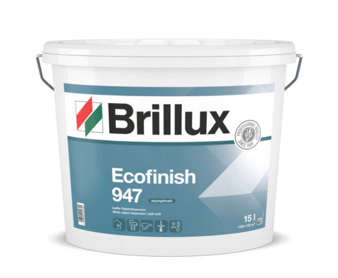

# Häufige Fragen

## Ich will eine Wand streichen. Welche Farbe brauche ich? {#i-have-to-paint-the-wall-what-should-i-do}

Die Wände sind mit `Brillux Ecofinish 947` gestrichen. Leider gibt es die Farbe nur im 15-Liter-Eimer. Wenn du deine Wohnung streichen oder nur ein paar Stellen ausbessern willst, frag am besten erst in der WhatsApp-Gruppe nach. Vielleicht findest du Leute, mit denen du dir einen Eimer und die Kosten teilen kannst.

Die günstigsten Angebote findest du auf [www.idealo.de](https://www.idealo.de/preisvergleich/ProductCategory/9792.html?q=brillux%20947).

## An welchen Tagen wird der Müll abgeholt? {#on-which-days-is-the-garbage-collected}

Die verschiedenen Müllsorten werden an unterschiedlichen Wochentagen abgeholt. Die aktuellen Termine stehen in diesen `.pdf`-Dateien:

| | |
|-|-|
| Abfuhrkalender 2024 | [Abfuhrkalender_2024.pdf](../../faq/resources/Abfuhrkalender_2024.pdf) |
| Abfuhrkalender 2025 | [Abfuhrkalender_2025.pdf](../../faq/resources/Abfuhrkalender_2025.pdf) |

Du kannst die Termine auch direkt in den Kalender auf deinem Handy übernehmen. Tippe dafür auf die passende `.ics`-Datei:

| | |
|-|-|
| Abfuhrkalender 2024 | [Abfuhrkalender_2024.ics](../../faq/resources/Abfuhrkalender_2024.ics) |
| Abfuhrkalender 2025 | [Abfuhrkalender_2025.ics](../../faq/resources/Abfuhrkalender_2025.ics) |

## Der Lüfter im Bad läuft ständig. Ist das normal? {#the-fan-in-the-bathroom-is-always-on-is-this-normal}

Ja, das ist völlig normal. Der Lüfter hat einen Feuchtigkeitssensor und passt seine Drehzahl an die Luftfeuchtigkeit an. Ganz aus geht er aber nie.

## Wie funktioniert die Heizung? {#how-does-the-heating-system-work}

Die Heizung arbeitet mit warmem Wasser, das durch die Rohre der Fußbodenheizung und durch die Heizkörper an den Wänden fließt. Der Regler öffnet und schließt die Ventile, je nachdem, welche Temperatur du eingestellt hast.

Gut zu wissen:
- Die Heizung reagiert träge. Wenn du den Regler verstellst, kann es eine Weile dauern, manchmal sogar einen Tag, bis du einen Unterschied merkst.
- Wenn du Geld sparen willst, stell eine angenehme Stufe ein und lass sie dann so. Runterdrehen lohnt sich nur, wenn du länger nicht zu Hause bist.
- Stufe 3 am Regler entspricht ungefähr 22 °C.
- Wenn mit der Heizung etwas nicht stimmt, wende dich an [Bock Hausservice](../contacts/contacts.md#bock-hausservice).

Hier ist ein Erklärvideo, das jemand aus der WhatsApp-Gruppe gedreht hat.

<video src="../../faq/resources/heating_tutorial.mp4" width="100%" controls></video>

## Wie transportiere ich große Sachen wie Möbel, eine Matratze oder den Weihnachtsbaum? {#i-need-to-move-large-items-like-furniture-matress-or-a-christmas-tree---how-can-i-do-it}

Wenn du einen Führerschein hast, ist ein Mietwagen oder Transporter am einfachsten und wahrscheinlich auch am günstigsten. Bei Miles zum Beispiel mietest du ganz unkompliziert einen Transporter. Keine Angst vor der Größe: Dank der vielen Spiegel und der Rückfahrkamera fahren sie sich sehr leicht. Viele finden sie sogar einfacher als ein normales Auto.

Link: [https://miles-mobility.com/en-de/car-sharing/fleet](https://miles-mobility.com/en-de/car-sharing/fleet)

Natürlich geht auch eine klassische Autovermietung, zum Beispiel die [Sixt-Filiale](https://maps.app.goo.gl/U9kHDZdnmJA2JeCR6) in der Nähe von Adlershof.

## Meine Frage ist hier nicht beantwortet. Was jetzt? {#my-question-is-not-answered-here-what-should-i-do}

Stell deine Frage in der WhatsApp-Gruppe, hol dir einen Kaffee und warte auf die Antwort.

## Telekom-Vertreter klingeln ständig bei mir. Was kann ich tun? {#telekom-sales-people-are-bothering-me-what-can-i-do}

Fürs Erste kannst du den [Telekom-Hinweis (PDF)](../../faq/resources/telekom_notice.pdf) ausdrucken und an deine Tür kleben. Es gibt auch eine Sperrliste, auf die man sich setzen lassen kann, aber wie das genau funktioniert, ist noch nicht ganz klar.
