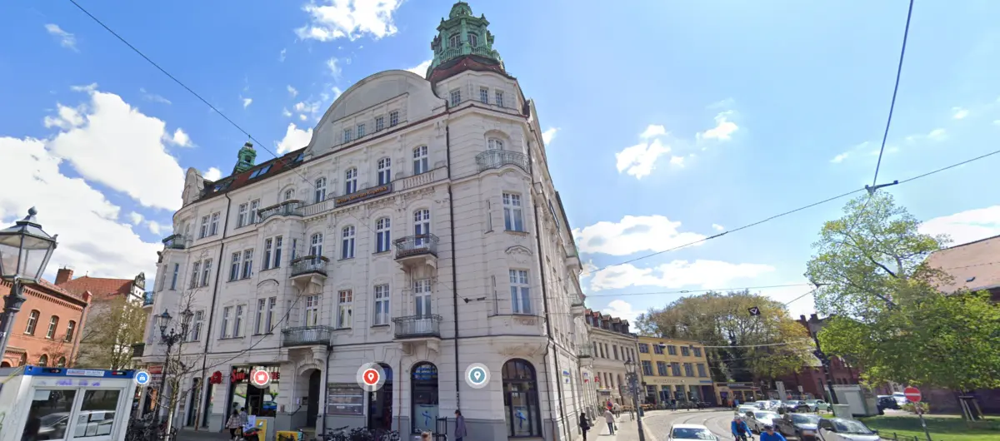
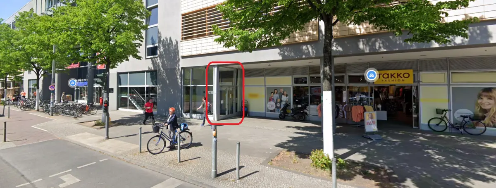
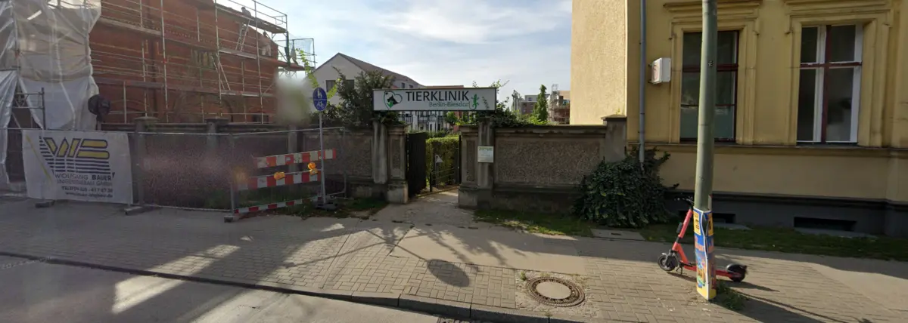
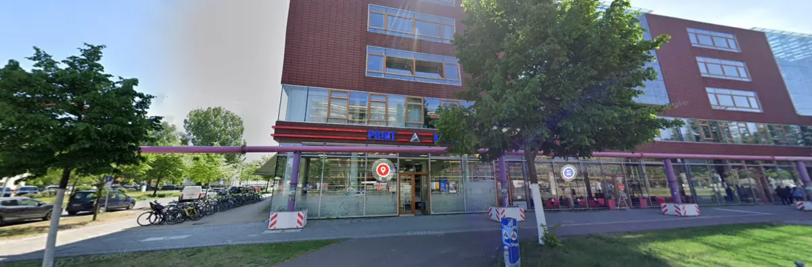
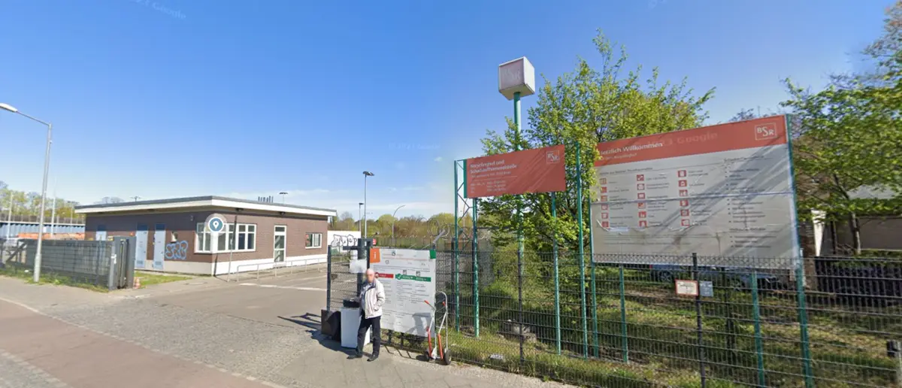
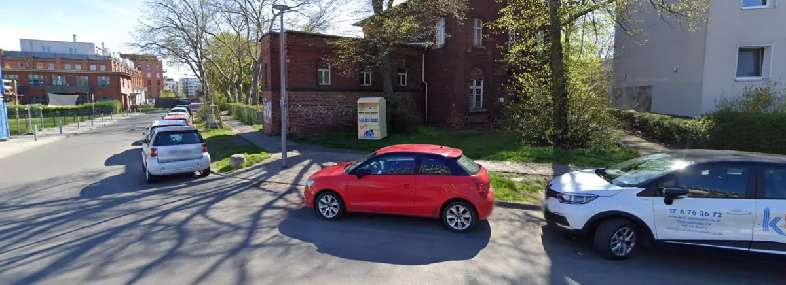
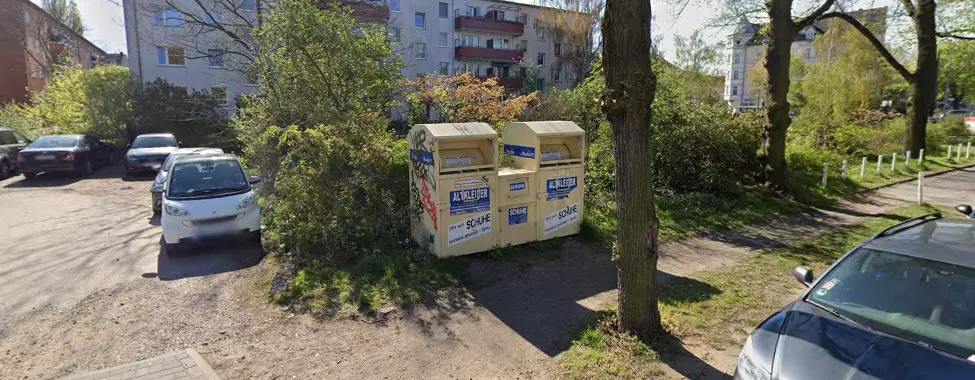

# In der Nähe

Hier findest du wichtige und nützliche Adressen in der Umgebung. Wenn du einen Tipp hast, melde dich gern auf einem der Wege, die unter [Mitmachen](../readme.md#contribution) stehen.

Bereiche
  - [Ärzte](#doctors)
  - [Tierärzte](#vets--animal-clinic)
  - [Drucken](#printing)
  - [Müll und Recycling](#garbage-collection-and-recycling)

## Ärzte {#doctors}

### Praxisgemeinschaft Freiheit 1 {#praxisgemeinschaft-freiheit-1}

| | |
|-|-|
| Fachrichtungen | Hausarzt, Physiotherapie |
| Sprachen | Deutsch, Englisch |
| Termin | Für manche Leistungen nötig, siehe Website |
| Adresse | [Freiheit 1, 12555 Berlin](https://maps.app.goo.gl/mxc2d49xbpRB9Zpz5) |
| Telefon | [030 - 655 72 25](tel:0306557225) |
| Website | [https://praxis-freiheit1.de](https://praxis-freiheit1.de) |

### Dr. Karsten Lange {#dr-karsten-lange}

| | |
|-|-|
| Praxis | Mehrere Ärztinnen und Ärzte |
| Fachrichtung | Hausarzt |
| Sprachen | Deutsch, Englisch (an der Anmeldung nur Deutsch) |
| Termin | Nicht nötig |
| Adresse | [Rudower Chaussee 12B, 12489 Berlin](https://maps.app.goo.gl/wHjzwBcPSFx6VwMy8) |
| Telefon | [030 - 67 19 88 88](tel:03067198888) |
| Website | [https://www.doctolib.de/allgemeiner-chirurg/berlin/karsten-lange-berlin?pid=practice-223319](https://www.doctolib.de/allgemeiner-chirurg/berlin/karsten-lange-berlin?pid=practice-223319) |

## Tierärzte {#vets--animal-clinic}

### AniCura Berlin-Biesdorf GmbH {#anicura-berlin-biesdorf-gbmh}

| | |
|-|-|
| Sprachen | Deutsch, Englisch (an der Anmeldung nur Deutsch) |
| Telefon | [030/5143760](tel:0305143760) |
| Adresse | [Alt-Biesdorf 22, 12683 Berlin](https://maps.app.goo.gl/8Go3UXew5Ad9HEuB9) |
| Website | [https://www.tierklinik-in-biesdorf.de](https://www.tierklinik-in-biesdorf.de/) |

## Drucken {#printing}

### Repro Kopier {#repro-kopier}

Ein professioneller Copyshop: Hier kannst du auch Hunderte Seiten drucken lassen, in Farbe oder Schwarz-Weiß.

| | |
|-|-|
| Sprachen | Deutsch, Englisch |
| Bezahlung | Bar und mit Karte |
| Öffnungszeiten | Mo-Fr 8-20 Uhr, Sa 10-17 Uhr |
| Adresse | [Rudower Chaussee 25, 12489 Berlin](https://maps.app.goo.gl/TJYN7PYK571JE2Rk6) |
| Website | [http://www.csvcopy.de/](http://www.csvcopy.de/) |

## Müll und Recycling {#garbage-collection-and-recycling}

### Recyclinghof Oberspreestraße {#recyclinghof-oberspreestraße}

Hier kannst du unter anderem abgeben:
- Altbatterien (auch Akkus)
- Elektrogeräte (Laptops, Handys, Kühlschränke)
- Sperrige Haushaltsgegenstände (Matratzen, Möbel)

Was genau angenommen wird, steht auf der Website der BSR.

| | |
|-|-|
| Sprachen | Deutsch |
| Adresse | [Oberspreestraße 109, 12555 Berlin (Treptow-Köpenick)](https://maps.app.goo.gl/WCnPVRG7KgMqrHJp8) |
| Website | [https://www.bsr.de/recyclinghoefe-20503.php](https://www.bsr.de/recyclinghoefe-20503.php) |

### Container für Altkleider und Schuhe {#used-clothesshoes-collection-points}

Statt alte Kleidung und Schuhe wegzuwerfen, kannst du sie zum nächsten Sammelcontainer bringen.

#### Vor dem Märkischen Sozial- und Bildungswerk {#in-front-of-the-märkisches-sozial--und-bildungswerk}

Dieser Container ist eher klein, dafür ganz in der Nähe.

| | |
|-|-|
| Adresse | [Bei der Ottomar-Geschke-Str. 11, 12555 Berlin](https://maps.app.goo.gl/LEE3n2acY3wqqhVV8) |

#### Am S-Bahnhof Spindlersfeld {#near-s-bahn-spindlersfeld}

Hier stehen mehr Container, dafür ist der Weg etwas weiter.

| | |
|-|-|
| Adresse | [Bei der Ottomar-Geschke-Str. 48, 12555 Berlin](https://maps.app.goo.gl/AMJGdA2Wq7VySqAc6) |
