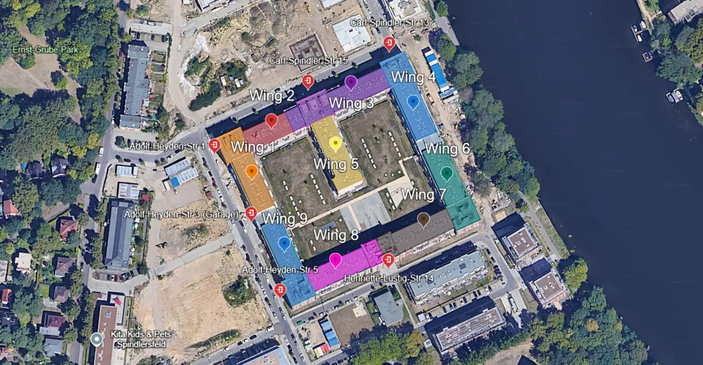

# Lagepläne

Hier findest du verschiedene nützliche Pläne.

## Die Flügel des Gebäudes {#wings-of-the-building}

Dieser Plan stammt aus einem [Google-Earth-Projekt](https://earth.google.com/earth/d/1wL9vX30Bzxr9eJdmouX-m0lGuk-UlAH_?usp=sharing).

> Hinweis: Bei den Wohnungen im obersten Stockwerk stimmt in der aktuellen Version noch nicht alles, daran wird gearbeitet.

### Pläne zum Ausdrucken {#some-maps-are-prepared-to-be-printed-please-mark-the-actual-location-with-a-circle-after-printing-it}

Markier nach dem Drucken mit einem Kreis, wo genau du wohnst.

||||
|-|-|-|
|Gebäudeflügel | farbig | [Herunterladen](../../maps/resources/wings_colored.pdf) |
|Gebäudeflügel | schwarz-weiß | [Herunterladen](../../maps/resources/wings_bw.pdf) |
|Eingänge und Flügel | druckerfreundlich, farbig | [Herunterladen](../../maps/resources/entrances_and_wings_colored.pdf) |
|Eingänge und Flügel | druckerfreundlich, schwarz-weiß | [Herunterladen](../../maps/resources/entrances_and_wings_black_and_white.pdf) |
