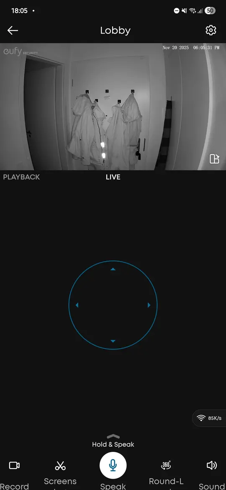
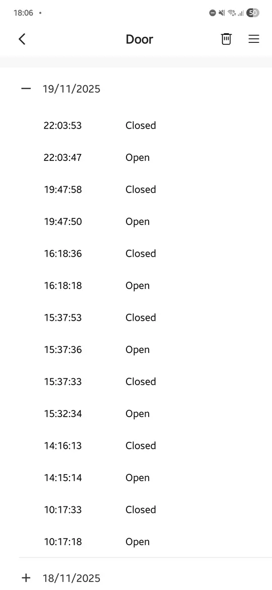
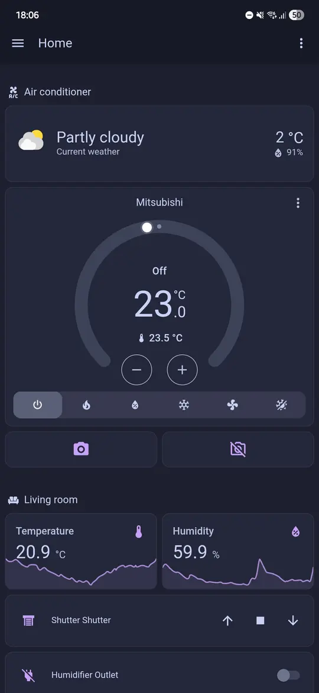
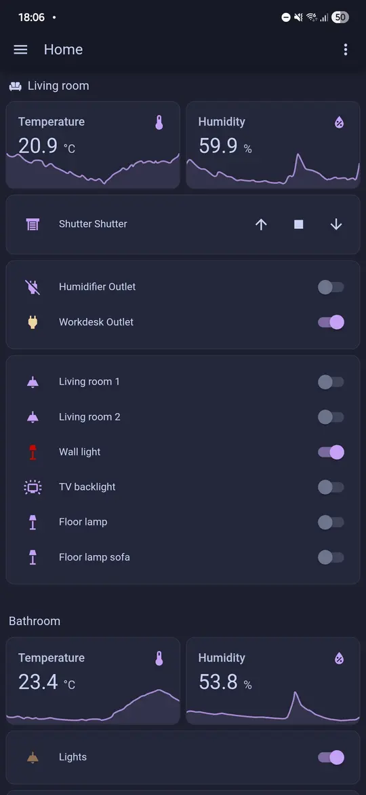

# Smart-Home-Lösungen

## Worum es geht {#introduction}

Auf dieser Seite findest du Ideen, wie du deine Wohnung mit ein paar smarten Geräten sicherer machen kannst. Die empfohlenen Geräte kaufst du selbst (außer bei Kit 3), aber bei Fragen hilft dir die WhatsApp-Gruppe, oder du meldest dich direkt bei mir.

Das kann ein gutes Smart Home zum Beispiel:
- Dir eine Nachricht aufs Handy schicken, wenn jemand in deiner Wohnung ist, während du weg bist (Einbrecher, verflossene Liebschaften oder einfach Gespenster!)
- Einen lauten Alarm auslösen, wenn jemand ohne Erlaubnis deine Wohnung betritt
- Eindringlinge filmen und die Aufnahme in der Cloud speichern
- Dich nach deinem Haustier schauen lassen, während du arbeitest
- Dich im Urlaub nach der Wohnung sehen lassen
- An heißen Sommertagen schon vorher die Klimaanlage einschalten, damit dich nach einer langen Reise oder einem Abend unterwegs eine angenehm kühle Wohnung erwartet
- Die Rollläden automatisch steuern: Tagsüber freuen sich deine Pflanzen über das Licht, nachts bleibt die Wärme drinnen

## Häufige Fragen {#frequently-asked-questions}

**Ist das sicher?**
> Ja. Wenn die Kamera ausgeschaltet ist, schließt sie automatisch ihre Linse. Sie nimmt dich also nicht auf und beobachtet dich nicht, solange du sie nicht einschaltest. Das geht auch aus der Ferne mit deinem Handy.

**Hilfst du bei der Installation?**
> Wenn du Hilfe brauchst, gern. Die meisten Setups sind aber so einfach, dass du sie problemlos selbst einrichten kannst. Für aufwendigere, individuelle Lösungen biete ich die Installation an, das besprechen wir dann im Einzelnen.

**Sind die empfohlenen Geräte zuverlässig?**
> Ja, sie laufen seit Jahren in mehreren Haushalten in meiner Familie, und bisher gab es keine Probleme.

**Welche Lösung empfiehlst du mir?**
> Probier am besten erst die einfachste Variante aus und schau, wie sie dir gefällt.

**Passen die Geräte zu meinem bestehenden Smart Home?**
> Das kommt darauf an: Apple HomeKit wird unterstützt, bei Google und Alexa hängt es vom Gerät ab.

**Muss meine Wohnung irgendwelche Voraussetzungen erfüllen?**
> Ja, du brauchst einen WLAN-Router, der das 2,4-GHz-Band unterstützt.

## Smart-Home-Kits {#smart-home-kits}

### Kit 1: Einfacher Einbruchschutz {#kit-1---basic-break-in-protection}

- Eine smarte Kamera (für iOS und Android, auch mit Apple HomeKit kompatibel)
- 2K-Auflösung, Tag- und Nachtmodus
- Per Handy ein- und ausschalten
- Bewegungserkennung
- Mit Kamerahalterung und Netzteil

#### Beispielfoto

#### Geschätzte Kosten

| Wohnungstyp | Geräte inklusive Installation | Optionale monatliche Kosten |
|-------------|-------------------------------|-----------------------------|
| Eine Wohnungstür, typisch für die oberen Etagen | ca. 45 EUR | 2,50 EUR für Video-Cloudspeicher |
| Zwei Türen, typisch für Wohnungen im Erdgeschoss | ca. 65 EUR | 5 EUR für Video-Cloudspeicher |

Einkaufsliste:
- [Eufy-2K-Kamera](https://www.amazon.de/-/en/Security-Surveillance-Swivelling-Detection-Compatible-White/dp/B086LBCQJL)
- [Klebe-Regal, um die Kamera ohne Bohren anzubringen](https://www.amazon.de/PAVSTINE-Floating-Drilling-Adhesive-Thickened/dp/B0CNGLG5TT)

## Kit 2: Mehr Einbruchschutz und ein Auge aufs Haustier {#kit-2---advanced-break-in-protection-and-pet-observation}

- Türsensor, der meldet, wenn die Tür aufgeht
- Zwei smarte Kameras, eine am Eingang und eine in der Wohnung (mit Apple HomeKit kompatibel, mit eigener Android-App)
- 2K-Auflösung, Tag- und Nachtmodus
- Per Handy ein- und ausschalten
- Bewegungserkennung für Haustiere und Menschen
- Mit Kamerahalterung
- Die Kameras lassen sich aus der Ferne schwenken, mit 360-Grad-Rundumblick
- Lautsprecher und Mikrofon in der Kamera, damit du aus der Ferne mit deinem Haustier sprechen kannst

#### Geschätzte Kosten

| Wohnungstyp | Geräte inklusive Installation | Optionale monatliche Kosten |
|-------------|-------------------------------|-----------------------------|
| Eine Wohnungstür, typisch für die oberen Etagen | ca. 100 EUR | 5 EUR für Video-Cloudspeicher |
| Zwei Türen, typisch für Wohnungen im Erdgeschoss | ca. 130 EUR | 5 EUR für Video-Cloudspeicher |

Einkaufsliste:
- [Eufy-2K-Kamera](https://www.amazon.de/-/en/Security-Surveillance-Swivelling-Detection-Compatible-White/dp/B086LBCQJL)
- [Klebe-Regal, um die Kamera ohne Bohren anzubringen](https://www.amazon.de/PAVSTINE-Floating-Drilling-Adhesive-Thickened/dp/B0CNGLG5TT)
- [Meross-Türsensor (unbedingt die Variante mit Hub nehmen!)](https://www.amazon.de/Requires-Magnetic-Real-time-Compatible-SmartThings/dp/B0CC9KN17N)

#### Beispielfotos

## Kit 3: Dein individuelles Smart Home {#kit-3---custom-smart-home-kit}

Möglich ist zum Beispiel:
- Smarte Kameras, die sich aus der Ferne steuern lassen (erkennen Menschen und Haustiere, mit Lautsprecher, um mit dem Haustier zu sprechen)
- Tür- und Fenstersensoren
- Dachfenster, die automatisch und aus der Ferne öffnen und schließen
- Deckenlampen steuern und automatisieren (zum Beispiel automatisch einschalten, wenn du nach Hause kommst)
- Ein eigener Smart-Home-Server mit Home Assistant
- Zugriff auf dein Smart Home von jedem Gerät aus, ob Computer, Tablet oder Handy
- Videos auf dem eigenen Server speichern, also ohne monatliche Gebühren, mit Backup bei einem Cloud-Anbieter deiner Wahl
- Alles an einem Ort: Jedes Gerät lässt sich über die Oberfläche von Home Assistant steuern
- Benutzerverwaltung: Du kannst Gäste hinzufügen und festlegen, worauf sie Zugriff haben

Wenn du mehr wissen willst, schreib mir auf WhatsApp oder in der gemeinsamen Gruppe.

#### Beispielfotos

#### Geschätzte Kosten
Die Kosten lassen sich hier schwer schätzen. Los geht es bei etwa 200 EUR, und je mehr smarte Geräte du möchtest, desto mehr kommt dazu.
